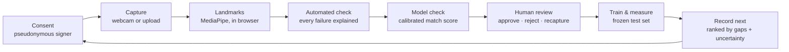
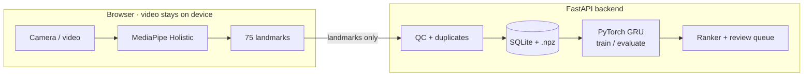

<div align="center">

# SIGNFORGE

**From a few native signs to a model-ready corpus.**

An AI-powered corpus builder for low-resource sign languages. It collects consented sign clips as motion landmarks,
checks and reviews every clip, measures a model on them, and tells you **which sign to record next**.

[**Live demo →**](https://bhaveshlakhmani25-ui.github.io/signforge/) &nbsp;·&nbsp; [Pitch deck](docs/pitch/SIGNFORGE_Round2_Build.pdf) &nbsp;·&nbsp; [Model card](docs/MODEL_CARD.md) &nbsp;·&nbsp; [Data governance](docs/DATA_GOVERNANCE.md)

      

*Aavishkar FET Hackathon · Team Claude's Clan*

</div>

---

## The problem

> **Problem statement:** Low-resource sign-language corpus builder using motion-capture transfer learning.

Over 70 million Deaf people use more than 300 sign languages, but sign-language AI is held back by a **data bottleneck, not zero data**.
Datasets exist (for Indian Sign Language: INCLUDE, iSign) but they are small, fragmented, labelled inconsistently, recorded from
few signers, and often gathered without clear consent. Teams have no tool that answers the question that matters most:
**what data should we collect next?**

## What SIGNFORGE does



Every step is a working page. Raw video never leaves the browser: only body and hand landmark coordinates are stored.

| Feature | What it does |
|---|---|
| **Consented capture** | Pseudonymous signer codes, consent per use, webcam or uploaded clip, a readiness check, 1/3/5 takes in a row, and *add a new sign* |
| **Automated quality check** | Flags too-short clips, missing hands or body, hand dropouts, left/right swaps, out-of-frame signing and exact duplicates, each with a readable reason |
| **Model check** | A calibrated match score from a model of the *same* sign language. It never marks a sign "correct"; auto-accept stays off until the model passes its reliability check |
| **Corpus & review** | Approve, reject or request recapture with the reviewer's role; delete clips; withdraw consent (optionally erasing the landmarks) |
| **What to record next** | Ranks signs by coverage gap, signer gap and model uncertainty, explains each pick, and opens Capture prefilled |
| **Models & evaluation** | GRU baseline with a frozen test split, accuracy, macro-F1, confusion matrix and temperature-scaled calibration |
| **Interpret** | Reads signing live from the camera, or turns an uploaded video into a timed transcript |
| **Learn signs** | Watch real dataset clips as a skeleton, copy them on camera, and get a match score |
| **Export** | Model-ready landmarks plus a manifest with provenance, licence and consent status per clip |

### Results so far

Measured on the **same frozen test clips** before and after adding augmentation and dropout (chosen on the validation split only, 3 seeds):

| | Before | After |
|---|---:|---:|
| ISL accuracy (INCLUDE, 17 signs, 59 test clips) | 55.9% | **78.0%** |
| ISL macro-F1 | 0.53 | **0.77** |
| ISL calibration error (ECE, limit 0.10) | 0.112 | **0.067** ✓ |
| ASL accuracy (16 signs, 22 test clips) | 18.2% | 27.3% |

**Limits, stated plainly:** INCLUDE has no signer IDs, so these are session-grouped, not signer-independent results. ALRIGHT is still 0/4.
Transfer learning is **not done yet**: no pretrained checkpoint has been verified as compatible with our landmarks, so the app shows it as blocked rather than calling random weights "pretrained".

## Architecture



**Model pipeline** (identical for training, the live camera and the in-browser port):
`frames → 75 landmarks (33 body + 2×21 hand) → 27 points, x/y → 30 frames at 10 fps → shoulder-centred normalisation → GRU (128) + dropout → temperature-scaled softmax`

| Layer | Stack |
|---|---|
| Frontend | Next.js 16 · React 19 · TypeScript · Tailwind CSS 4 |
| Vision | MediaPipe Holistic Landmarker in the browser (GPU, with CPU fallback) |
| Backend | Python · FastAPI · SQLModel · SQLite (Postgres-ready via `DATABASE_URL`) |
| ML | PyTorch GRU · NumPy · temperature scaling |
| Hosting | GitHub Pages + Actions; the model and QC are ported to TypeScript for the server-free demo |
| Quality | 83 pytest tests · browser-vs-backend parity checks (16/16 readings, 33/33 QC results) |

## Quick start

Requires Python 3.14 and Node 24 (macOS tested).

```bash
# 1. Backend
cd backend && python3 -m venv .venv && .venv/bin/pip install -r requirements.txt
.venv/bin/python scripts/seed.py --demo        # ISL demo project with labelled DEMO DATA
.venv/bin/uvicorn app.main:app --port 8000
```

```bash
# 2. Frontend (second terminal)
cd frontend && npm install && npm run setup:models   # MediaPipe WASM + holistic_landmarker.task (13.7 MB)
npm run dev                                          # http://localhost:3000
```

```bash
# Tests
cd backend && .venv/bin/pytest
cd frontend && npm run typecheck && npm run lint && npm run build
```

> Schema changes are not migrated yet: after pulling a model change, move `backend/signforge.db` and `data/processed/` aside and re-run `seed.py`.

## The public demo (no server)

The [live site](https://bhaveshlakhmani25-ui.github.io/signforge/) is a static GitHub Pages build. When the repository variable
`API_URL` is unset it runs in **snapshot mode**:

- Corpus, models and dashboards read a frozen, public-safe snapshot (`frontend/public/snapshot/`): external datasets and DEMO DATA only, never team clips, signers, consents or reviews.
- **Interpret, Learn signs and Capture work fully in the browser.** The GRU and the automated check run as TypeScript ports, verified against the Python backend by `node deploy/pages/check_local_interpret.ts`.
- Clips recorded on the public site are saved **only in that visitor's browser** (IndexedDB) and can be downloaded as JSON; nothing is sent to the team.
- Visitors can add a sign and retrain the model's output layer in the browser on the frozen GRU features plus their approved clips.

Refresh the snapshot after changing data or models:

```bash
python deploy/hf-space/build_space.py
backend/.venv/bin/python deploy/pages/export_snapshot.py   # then commit frontend/public/snapshot
```

<details>
<summary><b>Deploying with a live backend</b></summary>

- **Backend:** `uvicorn app.main:app --host 0.0.0.0 --port $PORT`. Set `CORS_ORIGINS` to the frontend URL. `DATABASE_URL` and `SIGNFORGE_DATA_DIR` need a persistent disk, or the corpus is lost on restart. A Docker image for a Hugging Face Space is assembled by `deploy/hf-space/build_space.py` (public-safe data only).
- **Frontend:** set `NEXT_PUBLIC_API_URL` **before** `npm run build` (it is baked into the build). Setting the repository variable `API_URL` switches the Pages site from snapshot mode to live mode.
- **HTTPS is required** for the camera (or `localhost`).
- Weights and imported datasets live under `SIGNFORGE_DATA_DIR` and are not in git.

</details>

## Data, consent and honesty

- **Consent first.** Recording is blocked until consent is recorded. Signers are pseudonymous codes, consent is per use, and withdrawal stops all further use and can erase the landmarks. See [DATA_GOVERNANCE.md](docs/DATA_GOVERNANCE.md).
- **Privacy by pose.** Only landmarks are stored, never raw video. Landmarks are still treated as sensitive data, not as anonymous.
- **A person decides.** The automated check judges capture quality only, and the model check is a match score; whether a sign is correct is always a human review decision, recorded with the reviewer's self-declared role.
- **No fabricated metrics.** Every number in the app is a real run output. DEMO DATA is synthetic, always badged, and excluded from evaluation by default.

| Dataset | Use | Licence |
|---|---|---|
| [INCLUDE](https://zenodo.org/records/4010759) (AI4Bharat), Greetings + Pronouns | ISL training and benchmark | CC BY 4.0 |
| [ASL Signs](https://www.kaggle.com/competitions/asl-signs) (Kaggle) | ASL project | Competition rules; research/demo use |
| Team recordings | Testing the loop | Own consent records, not published |

## Repository layout

```text
backend/    FastAPI app, services (QC, preprocessing, ranker, triage, calibration), scripts, tests
frontend/   Next.js app: landing page + workbench (capture, corpus, queue, models, interpret, learn, export)
deploy/     GitHub Pages snapshot export + parity checks, Hugging Face Space bundle
docs/       Model card, data governance, interpreter notes, pitch deck, test reports
```

## Documentation

[Model card](docs/MODEL_CARD.md) · [Data governance](docs/DATA_GOVERNANCE.md) · [Interpreter](docs/INTERPRETER.md) · [Ranker contract](docs/RANKER_CONTRACT.md) · [INCLUDE provenance](docs/DATA_PROVENANCE_INCLUDE.md) · [Extractor comparison](docs/EXTRACTOR_COMPARISON.md) · [Competitive positioning](docs/DIFFERENTIATION.md) · [Browser tests](docs/BROWSER_TESTS.md)

## Roadmap

- **More data:** import INCLUDE *People* (10 signs, archives already checksum-verified); more signers per sign.
- **Better accuracy:** verify a pretrained pose checkpoint for real transfer learning; target weak signs; signer-independent evaluation.
- **Platform:** a shared hosted backend for team collection, native and Deaf reviewer onboarding, mobile capture, ELAN-compatible export.

## Team

**Team Claude's Clan** · Tashvi Adhlakha (Team Leader) · Bhavesh Lakhmani · Reuben Raju · Aakarshi Dwivedi

Contributor notes: project rules live in [CLAUDE.md](CLAUDE.md). The repo enables the *ponytail* Claude Code plugin, which keeps changes small and marks known limits in code as `shortcut: <limit>, <when to upgrade>` (`/ponytail-debt` lists them).

## Acknowledgements

- [INCLUDE](https://zenodo.org/records/4010759) — Sridhar et al., *INCLUDE: A Large Scale Dataset for Indian Sign Language Recognition*, ACM MM 2020.
- [AI4Bharat OpenHands](https://github.com/AI4Bharat/OpenHands) (Apache-2.0) — the 27-point preprocessing we replicate.
- [MediaPipe Holistic Landmarker](https://developers.google.com/edge/mediapipe/solutions/vision/holistic_landmarker) — Google AI Edge.
- Choosing which sign to collect next has prior work (Bicego et al., 2023, *Active Class Selection for Dataset Acquisition in Sign Language Recognition*); SIGNFORGE's contribution is the integrated, measured, consent-first workflow.

No open-source licence has been chosen yet; all rights reserved by the team until one is added.
